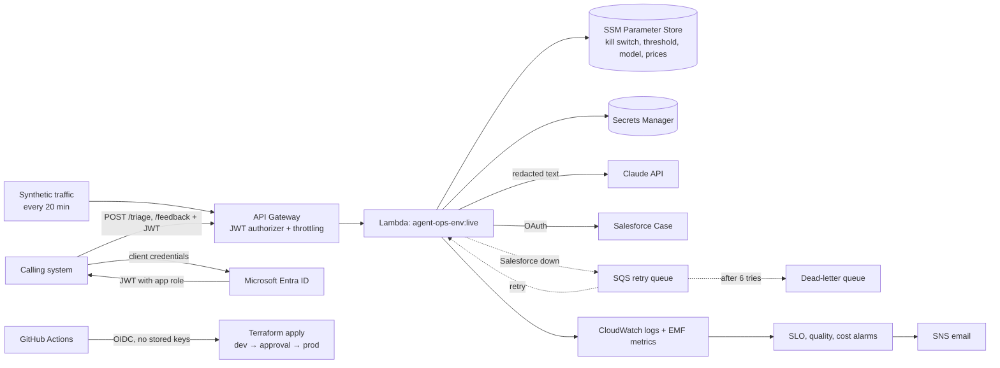

# Agent Ops: running an AI support agent like a production service

A member-support triage agent for an airport-lounge access programme, built to show the **operational layer** that makes AI safe to run in a business: identity and access control, secrets, infrastructure-as-code, deployment controls, rollback, monitoring and SLOs, live quality and cost tracking, failure recovery, runbooks, and six days of actual operation.

> Portfolio project with synthetic data and simulated traffic. It is designed and operated the way I would run it in production, but it has no real users.

## What it does

1. A member complaint arrives at `POST /triage` (API Gateway, Entra ID JWT).
2. Personal data (emails, card numbers, phone numbers) is redacted.
3. Claude classifies it (category, urgency, confidence, risk flags) and drafts a reply. The output is validated, with one self-correction retry. The cost is recorded.
4. Routing: high confidence goes to a Case. Low confidence, risk flags or invalid AI output go to a Case marked **[REVIEW]** for a human. Kill switch on means the AI is skipped entirely.
5. A Salesforce Case is created through OAuth client credentials. If Salesforce is down, the Case is queued and retried automatically.
6. Reviewer corrections arrive at `POST /feedback` and feed a live accuracy metric.
7. Every decision is logged as structured JSON and turned into CloudWatch metrics, SLOs and alarms.

## Architecture



   ## Operations record

   Production ran with synthetic traffic and simulated reviewer feedback from 7 Nov 2026 (about 08:15 SAST) to 13 Nov 2026 (13:19 SAST), about six days. Full report: [docs/OPERATIONS-REPORT.md](docs/OPERATIONS-REPORT.md).

   | Measure | Result | Target |
   |---|---|---|
   | Requests triaged | 628 | |
   | Success rate | 99.84% | 99% |
   | p90 latency | 4.75 s | under 10 s |
   | Sent to human review | 123 (19.6%), all for risk flags | under 50% |
   | Live accuracy | 95.9% (627 reviews) | 80% |
   | Salesforce Cases | 580 created (21 recovered through the retry queue), 0 dead-lettered | |
   | AI cost | $0.90, about $0.0014 per triage | under $7 a week |
   | Incidents | 1 unplanned (provider 503), 1 drill, 1 recurring alarm-noise finding | |
   | Deployments | 6, all green | |

## Operations record

Production has been running with synthetic traffic since 7 November 2026. *(Filled in after the operating period: see [docs/OPERATIONS-REPORT.md](docs/OPERATIONS-REPORT.md).)*

## Repository

```
bootstrap/              one-time: state bucket, GitHub OIDC roles, budget
infra/                  the agent's infrastructure (Terraform), env/dev.tfvars + env/prod.tfvars
src/                    Lambda code (Node.js 22, no dependencies) and versioned prompts
traffic/                synthetic traffic generator + simulated reviewer
tests/                  unit tests (validation, redaction, cost)
evals/                  labelled cases + eval gate script
scripts/                smoke test, token and test helpers
runbooks/               incident and operational procedures
docs/                   SLOs, dependency map, incident reports, weekly ops reviews, operations report
.github/                CI, deploy and rollback workflows
```

## Runbooks

1. [Claude API outage](runbooks/01-claude-api-outage.md)
2. [Salesforce integration down](runbooks/02-salesforce-integration-down.md)
3. [Bad release, rollback and pipeline problems](runbooks/03-bad-release-rollback.md)
4. [Access requests and denials](runbooks/04-access-requests-and-denials.md)
5. [Decommission an agent](runbooks/05-decommission-agent.md)
6. [AI quality drop or cost anomaly](runbooks/06-ai-quality-and-cost.md)

See also the [dependency map](docs/DEPENDENCIES.md).

## Known limitations / next steps

- Two environments. A real deployment would add staging between dev and prod, and a Salesforce sandbox for dev (today dev and prod share one org).
- If the Claude API is down, `POST /triage` returns 500 and the request is not queued. The kill switch is the manual response. Next step: an automatic fallback to human review.
- The Salesforce integration runs as an admin user. Next step: a dedicated integration user with an API-only licence and a permission set limited to Cases.
- The ratio alarms (human-review rate) have no minimum volume, so a quiet environment can fire on a tiny sample. Next step: ignore windows with fewer than 10 requests.
- The dead-letter queue replay is documented but not drilled.
- The deploy role is scoped to `agent-ops-*` resources. Next step: an IAM permissions boundary so it cannot create over-privileged roles.
- Reviewer feedback is simulated by the traffic generator. In production it would come from a Salesforce Flow when an agent corrects the category.
- Orchestration is code-first. In an organisation using Mindflow or n8n, the same controls would wrap those workflows.
- Redaction is pattern-based. A production version would add a dedicated PII-detection service.
- Secret rotation (Entra client secrets expire every 90 days) is a manual runbook step and could be automated.
- The alert email is stored as a repository variable, so it is visible in public workflow logs. In a private repository it would be a secret.
- A dedicated LLM observability tool (for example Langfuse) would add per-request traces of prompts and outputs.
